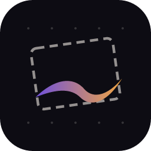
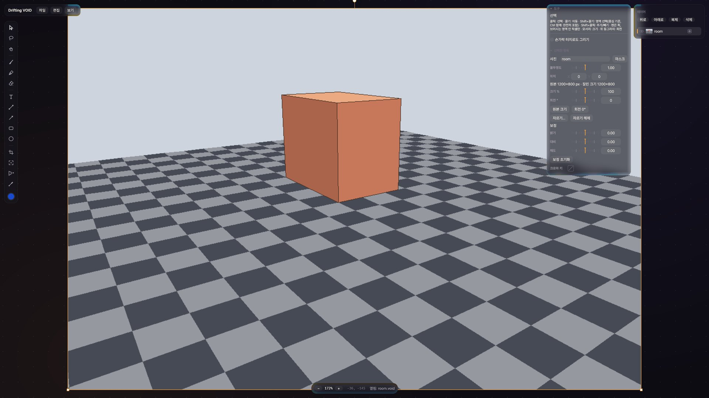
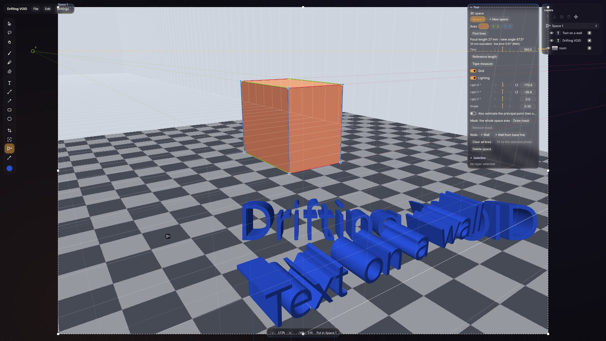
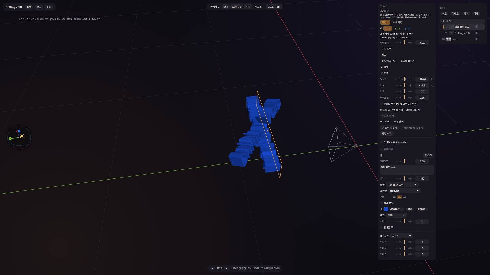
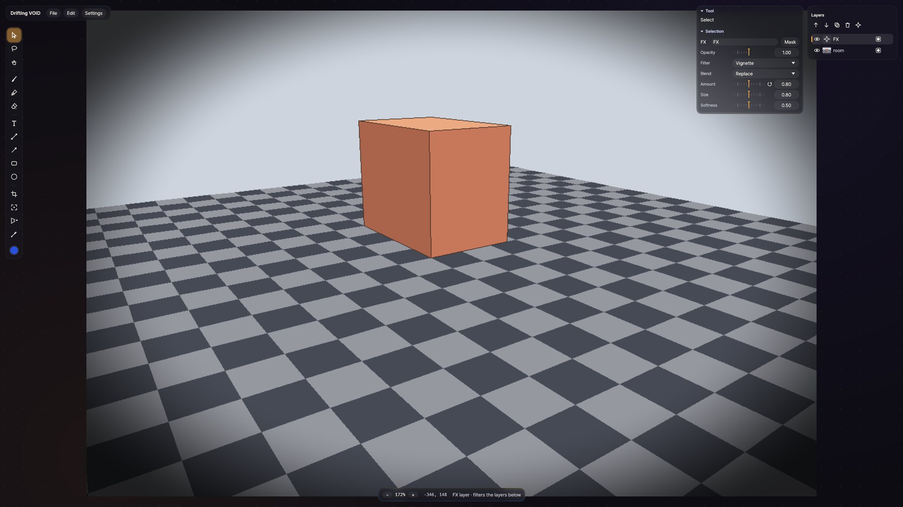
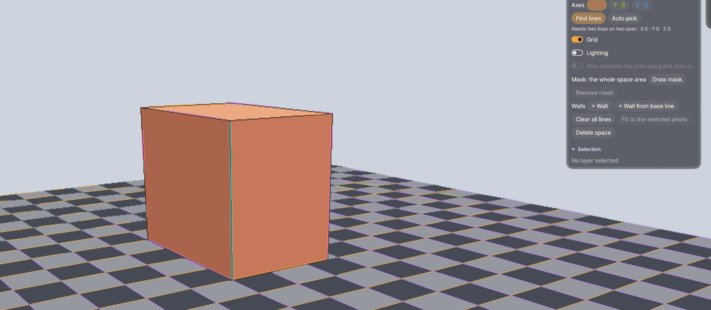

<p align="center">
  
</p>

<h1 align="center">Drifting VOID</h1>

<p align="center">
  An infinite canvas for photos, drawing and motion, made for pen tablets on Windows.
</p>

<p align="center">
  <a href="https://github.com/seven-ash/DriftingVOID/releases/latest"><b>Download</b></a> ·
  <a href="https://seven-ash.github.io/DriftingVOID/">Manual</a> ·
  <a href="CHANGELOG.md">Changelog</a> ·
  <a href="LICENSE">GPL-3.0-or-later</a>
</p>



Drop photos in at their original resolution, draw around and over them with
a pressure-sensitive brush or pen, add text and shapes, and export just the
part you want, as a picture or a video. The interface is in Korean, English
and Japanese.

## Features

- **Infinite canvas.** Photos keep their full resolution; zoom and pan freely
  with the wheel, the middle button, the pen's side button or Space.
- **Drawing.** A raster brush and a vector pen with pressure and smoothing,
  an eraser, lines, arrows, rectangles and ellipses, and an OKHSV palette
  (Alt + click).
- **Text and shapes** with outlines, padding and thickness.
- **Masks.** Paint masks, pick a region with a click, GrabCut a box, or
  trace precise edges with intelligent scissors.
- **FX layers.** Filters on the layers below: blur, motion blur, unsharp mask,
  levels, curves with per-side tangents, hue/saturation, gradient map,
  channel to alpha, grain, vignette, colour fringes, pixelate, halftone,
  glow and more; every value can be keyed.
- **3D spaces.** Match a photo's perspective from its vanishing lines, then
  place layers on its floor and walls, with a 3D workspace (Tab) and
  Blender-style G/R/S.
- **Timeline.** Keyframes per property, canvas cameras, video and sound
  clips, recorded strokes that replay, and video export (H.264, H.265, AV1,
  ProRes, VP9, GIF or PNG frames) through FFmpeg.
- **GPU rendering** with wgpu (DX12 or Vulkan) for the canvas, playback and
  every export.

| | |
|---|---|
|  |  |
|  |  |

## Install

1. Download `DriftingVOID-<version>-Setup.exe` from the
   [latest release](https://github.com/seven-ash/DriftingVOID/releases/latest).
2. Run it. It installs for your user only (no administrator rights) into
   `%LOCALAPPDATA%\Programs\DriftingVOID`.
3. Leave **Download FFmpeg** ticked if you want video and sound: the setup
   fetches the public GPL build from
   [BtbN/FFmpeg-Builds](https://github.com/BtbN/FFmpeg-Builds) and checks its
   SHA-256. FFmpeg is a separate program and is not part of this
   repository or the installer.

Later releases are announced inside the app, right of the menus; a click
downloads the new installer, checks it, and updates (switch it off in
*Settings → Check for updates*). Nothing else is sent anywhere.

The installer is not code-signed yet, so Windows SmartScreen may warn on
first run: choose **More info → Run anyway**. Uninstall from
*Settings → Apps*; your projects and settings
(`%APPDATA%\DriftingVOID`) are kept.

**Requirements:** Windows 10 or 11 (64-bit) and a GPU with DX12 or Vulkan.
A pen tablet is optional; the app is developed with a Super Display + S Pen
setup.

The user manual is in the Start menu after installing, and online at
[seven-ash.github.io/DriftingVOID](https://seven-ash.github.io/DriftingVOID/).

## First steps

| Input | Action |
| --- | --- |
| Drag files / Ctrl+V | Import photos, videos or sound (or paste text as a note) |
| Wheel | Zoom at the cursor |
| Middle drag / pen button / Space + drag | Pan |
| Ctrl + drag (brush, pen, eraser, shapes) | Change the size or stroke width |
| Alt + click | Colour palette |
| Tab | Switch between the 2D canvas and the 3D workspace (hold: peek) |
| Ctrl+T | Timeline |
| Ctrl+H | Hide or show the UI |

Tools: V select, Q lasso, H pan, B brush, P pen, E eraser, T text, L line,
A arrow, R rectangle, O ellipse, C crop, F export frame, K 3D space,
I eyedropper. The manual covers the rest.

## Build from source

```bash
cargo build --release
```

Needs a Rust toolchain with MSVC on Windows. The executable is
`target/release/DriftingVOID.exe`; opening a `.void` file passes it as the
first argument. Video and sound need `ffmpeg` and `ffprobe` next to the exe
(in `ffmpeg\bin`), in `%APPDATA%\DriftingVOID\ffmpeg`, or on `PATH`.

`cargo test --release` runs the tests (the GPU ones skip without a GPU).
`dist\package.ps1 -Release <version>` builds the zip and, with
[Inno Setup](https://jrsoftware.org/isinfo.php) 6.7 installed, the
installer (`dist/inno`).

More for developers: [`docs/BUILDING.md`](docs/BUILDING.md) (build, tests,
translations, manual, packaging, releases),
[`docs/ARCHITECTURE.md`](docs/ARCHITECTURE.md) (how it fits together) and
[`docs/ROADMAP.md`](docs/ROADMAP.md).

## Contributing

Pull requests are welcome. Contributions come under the project's licence
with a sign-off under the Developer Certificate of Origin (`git commit -s`);
see [`CONTRIBUTING.md`](CONTRIBUTING.md).

## Licence

Copyright (C) 2026 Ash (seven-ash).

Drifting VOID is free software under the
[GNU General Public License, version 3 or later](LICENSE), with additional
terms under its section 7 ([`NOTICE`](NOTICE)):

- keep the attribution *"Based on Drifting VOID by Ash (seven-ash),
  https://github.com/seven-ash/DriftingVOID"*;
- mark modified versions as changed;
- give a modified version a name and icon of its own (the licence grants no
  rights to the name "Drifting VOID" or its icons).

One source file, `src/lsd.rs` (the line segment detector), is a port of the
LSD reference code and stays under the
[GNU Affero General Public License, version 3 or later](LICENSE-AGPL);
`src/okhsv.rs` follows MIT-licensed reference code. Both are described in
[`NOTICE`](NOTICE).

Third-party components and their licences:
[`THIRD-PARTY-NOTICES.html`](THIRD-PARTY-NOTICES.html) (regenerate with
`cargo about generate -c dist/legal/about.toml dist/legal/about.hbs -o THIRD-PARTY-NOTICES.html`).
